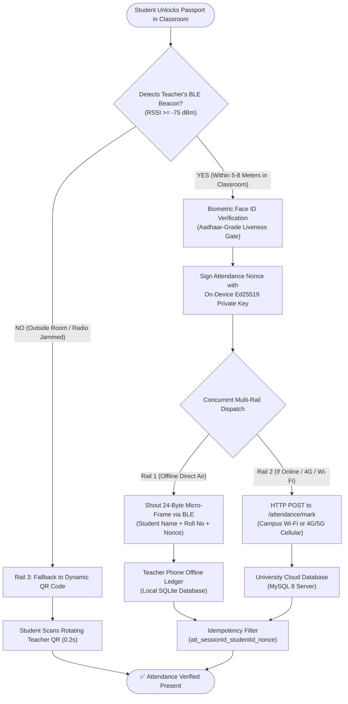
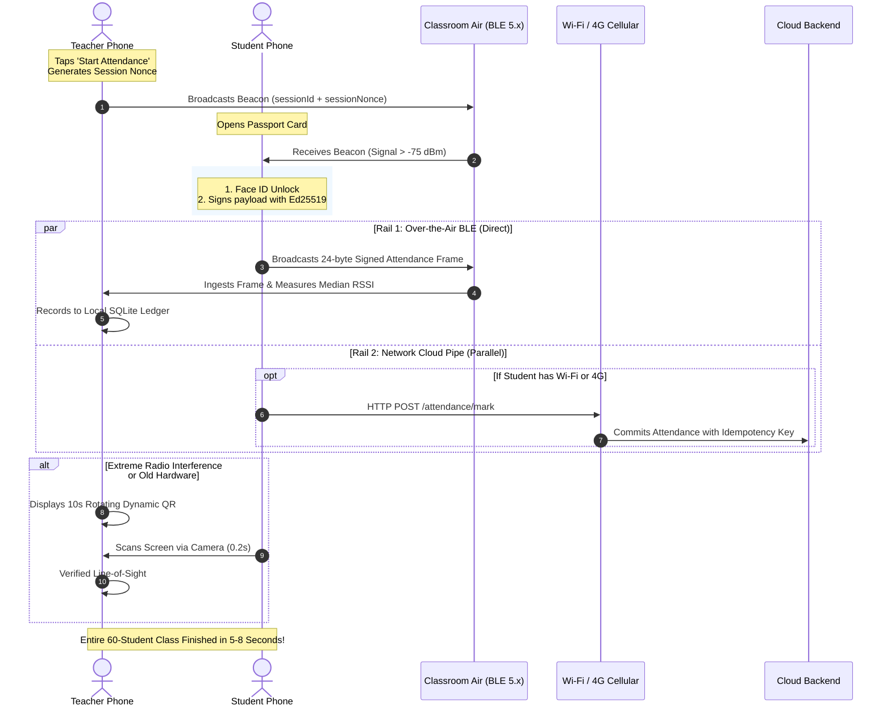
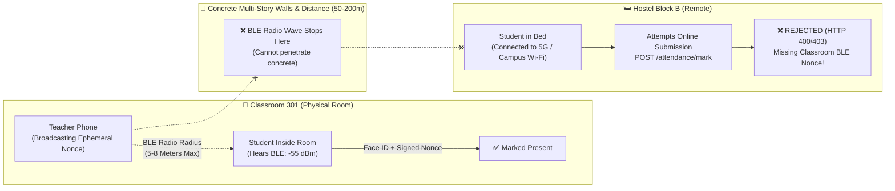
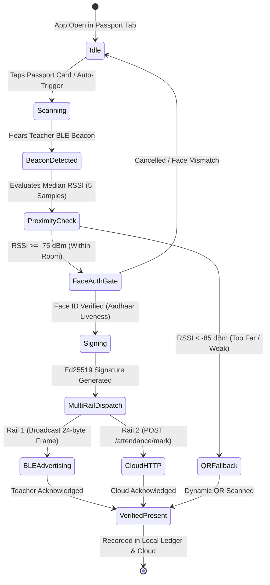

# CampusOS Hybrid Attendance Architecture
## The Simple, Complete Guide to How BLE + Wi-Fi + Mobile Data + Dynamic QR Work Together

---

## 1. What is this, and what problem are we solving?

In almost every college today, attendance has major headaches:
1. **Calling out roll numbers:** Wastes 10 to 15 minutes of every single class.
2. **Paper sign-in sheets:** Friends sign proxies for each other.
3. **Standard mobile apps (GPS/Wi-Fi):**
   - Students easily spoof their location using free **Fake GPS** apps from the Play Store while sleeping in the hostel.
   - Poor students without active 4G data recharges can't mark attendance.
   - In basement labs or ground-floor concrete halls, there is **zero mobile network (No Service)**.
   - If power goes out or a storm hits, campus Wi-Fi routers shut down.

### The CampusOS Mission
We designed an attendance system that is:
- **Instant:** Marks an entire class of 60+ students in **5 to 8 seconds**.
- **100% Anti-Proxy:** Mathematically and physically impossible to fake from outside the room.
- **Zero-Infrastructure & Disaster-Proof:** Works even with **no internet, no mobile towers, no Wi-Fi routers, and power cut off**.

---

## 2. Visual Architecture: The Concurrent Multi-Rail Engine

Imagine you need to urgently deliver an important signed message to your teacher in the same room. Instead of relying on just one road (which might have traffic or be blocked), your phone delivers it using **every available road at the same time**:

---

## 3. Step-by-Step Sequence: How It Works During a Live Class

Here is the exact timeline from the second the teacher starts the session to the second everyone is marked present:

---

## 4. Anti-Proxy Protection: Classroom vs. Hostel Barrier

Why is it physically and mathematically impossible for a student in the hostel to cheat, even if they share the campus Wi-Fi or use mobile data?

---

## 5. Detailed Breakdown of the 3 Rails

### Step 1: The Teacher Starts the Session
* The teacher opens the CampusOS Teacher App and taps **"Start Attendance"**.
* The teacher’s phone creates a unique, one-time random code called a **Session Nonce** (e.g., `nonce_9a8f2c`).
* The teacher's phone begins broadcasting this code into the air using **Bluetooth Low Energy (BLE)**.
* **Important:** The teacher does **NOT** turn on a mobile hotspot. The phone uses negligible battery (like playing music to Bluetooth earbuds).

### Step 2: The Student Detects the Class & Unlocks Face
* The student opens the CampusOS Student App and taps their **Campus Passport Card**.
* The student’s phone listens to the air and hears the teacher’s Bluetooth beacon.
  - **Distance Check:** The signal must be stronger than **`-75 dBm`**. This physical law guarantees the student is within 5 to 8 meters inside the classroom walls!
* The phone prompts for **Face ID** (on-device biometric verification).
* Once the face matches, the phone unlocks the student's hardware-backed cryptographic key and signs the attendance ticket.

### Step 3: Concurrent Multi-Rail Delivery (Both Pipes Fire)
Now, the student's phone tries to deliver the signed attendance ticket using **both rails simultaneously**:
1. **Rail 1 (Bluetooth Air Wave):** The student's phone broadcasts a micro-packet (only 24 bytes: name + roll number + signed ticket) straight over the air to the teacher's phone.
2. **Rail 2 (Network Pipe):** If the student's phone has an internet connection (college Wi-Fi or cellular 4G/5G data), it also fires a tiny HTTP message directly to the campus cloud server.

### Step 4: Instant Verification & Zero Duplication
* **If Rail 1 reaches the teacher:** The teacher's phone records the student as **PRESENT** in its local offline ledger.
* **If Rail 2 reaches the server:** The cloud database records the student as **PRESENT**.
* **What if BOTH succeed?**
  - Every attendance submission has a deterministic **Idempotency Key**:
    $$\text{idempotencyKey} = \text{att\_}\{\text{sessionId}\}\_\{\text{studentId}\}\_\{\text{nonce}\}$$
  - The database and the teacher's ledger automatically recognize that both packets belong to the exact same check-in. It records the student once and ignores the duplicate!

### Step 5: Rail 3 (The Universal QR Safety Net)
* What if a student has an old phone with broken Bluetooth AND zero mobile data?
* The teacher's screen displays a **10-second rotating Dynamic QR code**.
* The student points their camera at the teacher's screen.
* Scanning takes **0.2 seconds** and line-of-sight verifies physical classroom presence.

---

## 6. Student Verification Lifecycle (State Machine)

---

## 7. Why We Rejected the Other Ideas (The Engineering Secrets)

When designing this system, we explored other common ideas and rejected them for real engineering reasons:

### 1. Why NOT GPS?
- **Fake GPS apps:** Any student can download a free GPS faker on Android and set their pin to the classroom while sitting in their hostel bed.
- **Indoor Blindness:** GPS signals from space cannot penetrate concrete roofs. Indoors, accuracy drops to 30–50+ meters.
- **The Floor (Z-Axis) Trap:** GPS only measures flat latitude and longitude. It cannot tell the difference between Classroom 301 on the 3rd floor and the cafeteria or parking lot directly below it on the ground floor!

### 2. Why NOT Teacher Mobile Hotspot?
- Running a mobile hotspot for 8 classes a day will **turn the teacher’s phone into a frying pan and drain the battery before lunch**.
- Smartphones have a strict hardware limit: **they only allow 8 to 10 devices to connect at once**. A class of 60 students would crash the hotspot.

### 3. Why NOT Student Hotspots?
- A phone can only connect to **one Wi-Fi network at a time**.
- If 60 students turned on their hotspots, the teacher's phone would have to connect, obtain IP, receive data, and disconnect 60 separate times.
- $60 \text{ students} \times 5 \text{ seconds per connection} = \textbf{5 whole minutes}$ of waiting!

---

## 8. How CampusOS Handles Every Real-World Situation

| Real-World Scenario | What Happens in CampusOS? | Which Rail Saves the Day? |
| :--- | :--- | :--- |
| **Normal Campus Day** (Good 4G & Wi-Fi) | Rail 1 and Rail 2 both fire. Attendance is marked in under **50 milliseconds**. | **Rail 1 (BLE) + Rail 2 (Network)** |
| **Dense Classroom** (60+ students, radio noise) | If a few Bluetooth packets collide, Rail 2 (4G/Wi-Fi) instantly catches them. | **Rail 2 (Network Pipe)** |
| **Basement Lab / Dead Zone** (0 mobile signal, no Wi-Fi) | Rail 1 operates peer-to-peer through the air. Attendance finishes completely offline. | **Rail 1 (BLE Radio)** |
| **Student has No Mobile Data / SIM balance** | Doesn't matter! Rail 1 needs 0 internet and 0 mobile balance. | **Rail 1 (BLE Radio)** |
| **Severe Storm / Cyclone** (Power down, cell towers dead) | The system continues working 100% off-grid on phone battery alone. | **Rail 1 (BLE) + Rail 3 (QR)** |
| **Old Budget Phone** (Bluetooth advertising not supported) | Student points camera at teacher's rotating QR code on screen. Done in 0.2s. | **Rail 3 (Dynamic QR)** |

---

## 9. Frequently Asked Questions (FAQ)

### Q1: Can a student in the hostel mark attendance using their 4G mobile data?
**NO.** To submit attendance over mobile data, the app requires the teacher's secret ephemeral **Session Nonce**. That nonce is only broadcast inside the classroom via short-range Bluetooth ($\approx 5\text{--}8$ meters). Because Bluetooth cannot travel through concrete campus buildings to the hostel, the hostel student can never get the ticket to submit.

### Q2: Does the teacher need to buy a router or extra hardware?
**NO.** The system runs 100% in software using the standard Bluetooth and Wi-Fi chips already inside everyday smartphones.

### Q3: Does the teacher have to stay online?
**NO.** The teacher can take attendance completely in Airplane Mode. All verified students are safely stored in the teacher phone's local SQLite database. Whenever the teacher gets home or connects to Wi-Fi later, the app automatically syncs the records to the university cloud in one click.

---

### Key Takeaway for Your Team
CampusOS does not make you choose between Bluetooth, Wi-Fi, or QR. **It uses all of them together in a smart multi-rail hierarchy:**
- **Bluetooth** is the physical room anchor.
- **Wi-Fi & 4G** are the high-speed data boosters.
- **Dynamic QR** is the foolproof physical line-of-sight guarantee.
