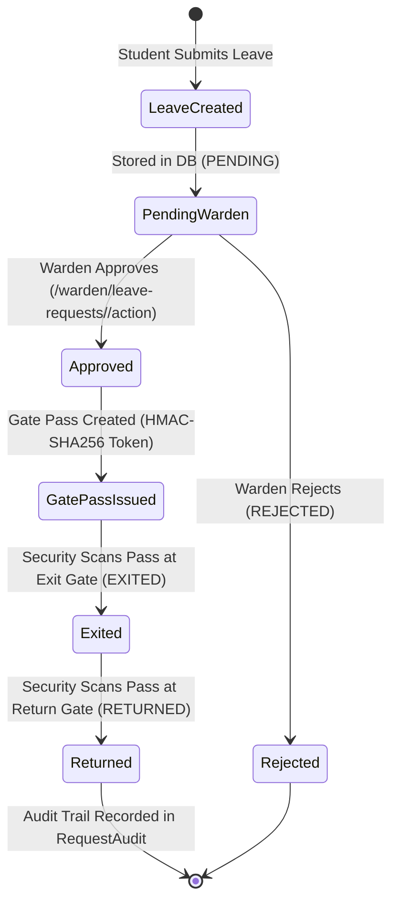
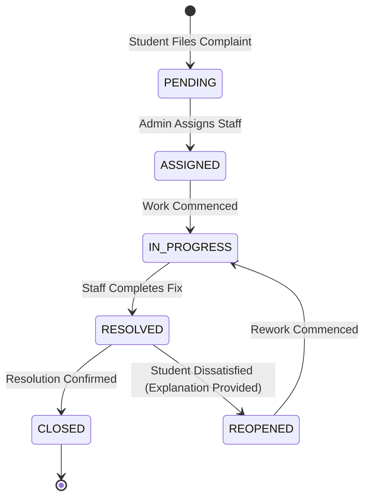

# CAMPUSOS QA TEST INVENTORY & SYSTEM SPECIFICATION

**Document Version:** 1.0 (Phase 4 Full QA)  
**Date:** 2026-09-28  
**Scope:** Complete frontend (Flutter 3.38.4) & backend (Flask/SQLAlchemy monolith) inventory across all 6 supported roles.  
**Hardware Target:** Samsung Galaxy A55 (`RZCX21VVWNB`, Android 16 / API 36, 120Hz)

---

## 1. Inventory Summary & Metrics

| Category | Count | Status | Exact Workspace Locations |
|:---|:---:|:---:|:---|
| **Named Routes** | **45** | Fully Mapped | `flutter_frontent/lib/router/app_routes.dart` |
| **Distinct Screen Widgets** | **47** | Verified | `flutter_frontent/lib/{student,teacher,admin,warden,mess,security,shared,auth,screens}` |
| **Navigation Dock Shells** | **6** | Verified (4 Tabs each) | `*_shell_screen.dart` across all 6 roles |
| **Modals & Bottom Sheets** | **16** | Audited | `showModalBottomSheet` across widget trees |
| **Confirmation Dialogs** | **19** | Audited | `showDialog` across screen controllers |
| **Backend API Endpoints** | **61** | Verified (11 Blueprints) | `backend/routes/*.py` |
| **User Roles** | **6** | Strict RBAC | `student`, `teacher`, `admin`, `warden`, `mess_staff`, `security` |
| **End-to-End Workflows** | **10** | Documented | Cross-domain integration paths |
| **State Machines** | **7** | Enforced | Leave, Gate Pass, Complaints, Notices, Menus, Sessions, Keys |
| **Offline Queues** | **3** | Idempotent | Security Gate Pass, Mess Entries, Local Trust Bundle |
| **Hardware Paths** | **6** | Validated | BLE Advertising, BLE Radar, Camera QR, Dynamic HMAC QR, Biometric Gate, Device Identity |

---

## 2. Complete Screen & Route Inventory (45 Routes, 47 Screens)

### A. Authentication & Onboarding (3 Routes, 3 Screens)
| Route Name | Screen Widget | File Location | Key Capabilities |
|:---|:---|:---|:---|
| `AppRoutes.splash` (`/`) | `SplashScreen` | `lib/screens/splash_screen.dart` | Animated wordmark, auto-login check, token restoration |
| `AppRoutes.onboarding` (`/onboarding`) | `OnboardingScreen` | `lib/auth/screens/onboarding_screen.dart` | Institutional value props, role discovery carousel |
| `AppRoutes.login` (`/login`) | `LoginScreen` | `lib/auth/screens/login_screen.dart` | Email/password auth, role-based shell routing, error banners |
| `AppRoutes.register` (`/register`) | `StudentRegistrationScreen` | `lib/auth/screens/student_registration_screen.dart` | Student account creation, PIN setup, department/year selection |

### B. Student Experience (7 Routes, 10 Screens)
| Route Name | Screen Widget | File Location | Key Capabilities |
|:---|:---|:---|:---|
| `AppRoutes.home` (`/home`) | `StudentShellScreen` | `lib/student/screens/student_shell_screen.dart` | 4-tab Apple dock (Home, Requests, Mess, Profile) |
| (Dock Tab 0) | `StudentHomeContent` | `lib/student/widgets/student_home_content.dart` | Live attendance hero, radar pulse trigger, quick notices |
| (Dock Tab 1) | `RequestsScreen` | `lib/student/screens/requests_screen.dart` | Leave requests, Gate Pass HMAC card, Complaint tracking |
| `AppRoutes.studentReady` (`/student/ready`) | `ReadyScreen` | `lib/student/screens/ready_screen.dart` | BLE radar discovery, rotating challenge handshake |
| `AppRoutes.studentSuccess` (`/student/success`) | `SuccessScreen` | `lib/student/screens/success_screen.dart` | Attendance verification receipt, coupon gamification |
| `AppRoutes.studentTimetable` (`/student/timetable`) | `TimetableScreen` | `lib/student/screens/timetable_screen.dart` | Weekly subject timetable, room numbers, teacher tags |
| `AppRoutes.studentAnalytics` (`/student/analytics`) | `StudentAnalyticsScreen` | `lib/student/screens/student_analytics_screen.dart` | Overall percentage gauge, subject breakdown, trends |
| `AppRoutes.studentProfile` (`/student/profile`) | `ProfileScreen` | `lib/student/screens/profile_screen.dart` | Student identity, registration number, Passport card |
| `AppRoutes.studentMess` (`/student/mess`) | `MessScreen` | `lib/student/screens/mess_screen.dart` | Daily meal menus, availability badges, feedback sheet |
| (Interactive Card) | `PassportScreen` | `lib/student/screens/passport_screen.dart` | Ed25519 digital credential, offline QR, rotation, biometric gate |
| `AppRoutes.passportVerify` (`/passport/verify`)| `PassportVerifierScreen`| `lib/student/screens/passport_verifier_screen.dart` | Camera QR scanning, offline trust bundle cryptographic check |

### C. Teacher Experience (8 Routes, 9 Screens)
| Route Name | Screen Widget | File Location | Key Capabilities |
|:---|:---|:---|:---|
| (Shell) | `TeacherShellScreen` | `lib/teacher/screens/teacher_shell_screen.dart` | 4-tab Apple dock (Home, Classes, Analytics, Profile) |
| (Dock Tab 0) | `TeacherHomeContent` | `lib/teacher/widgets/teacher_home_content.dart` | One-tap launchpad, recent sessions, quick start |
| `AppRoutes.teacherClasses` (`/teacher/classes`) | `TeacherClassesScreen` | `lib/teacher/screens/teacher_classes_screen.dart` | Assigned curriculum subjects, search, batch cards |
| `AppRoutes.teacherClassDetail` (`/teacher/class-detail`)| `ClassDetailScreen` | `lib/teacher/screens/class_detail_screen.dart` | Class attendance history, roster preview, launch session |
| `AppRoutes.teacherAnalytics` (`/teacher/analytics`) | `TeacherAnalyticsScreen` | `lib/teacher/screens/teacher_analytics_screen.dart` | Subject attendance curves, low attendance alert, device reset |
| `AppRoutes.teacherProfile` (`/teacher/profile`) | `TeacherProfileScreen` | `lib/teacher/screens/teacher_profile_screen.dart` | Teacher credentials, department status, secure sign out |
| `AppRoutes.teacherCreateSession` (`/teacher/create-session`)| `CreateSessionScreen` | `lib/teacher/screens/create_session_screen.dart` | Subject selection, room, duration, geo-fence radius |
| `AppRoutes.teacherBroadcasting` (`/teacher/broadcasting`)| `BroadcastingScreen` | `lib/teacher/screens/broadcasting_screen.dart` | Live attendance command center, BLE beacon, dynamic QR |
| `AppRoutes.teacherSessionAttendance` (`/teacher/session-attendance`)| `SessionAttendanceScreen`| `lib/teacher/screens/session_attendance_screen.dart` | Live roster check, manual toggle override |
| `AppRoutes.teacherPostSessionReport` (`/teacher/post-session-report`)| `PostSessionReportScreen`| `lib/teacher/screens/post_session_report_screen.dart` | Session closure summary, present/absent counts, export |

### D. Admin Experience (2 Routes, 6 Screens)
| Route Name | Screen Widget | File Location | Key Capabilities |
|:---|:---|:---|:---|
| (Shell) | `AdminShellScreen` | `lib/admin/screens/admin_shell_screen.dart` | 4-tab Apple dock (Home, Operations, Analytics, Profile) |
| (Dock Tab 0) | `AdminHomeContent` | `lib/admin/widgets/admin_home_content.dart` | Institutional command center, critical KPIs, quick links |
| (Dock Tab 1) | `AdminOperationsScreen` | `lib/admin/screens/admin_operations_screen.dart` | Operations hub (Complaints, Notices, Mess, Attendance, Gate) |
| (Dock Tab 2) | `AdminAnalyticsScreen` | `lib/admin/screens/admin_analytics_screen.dart` | Resolution rates, ageing brackets, recurring issue clusters |
| (Dock Tab 3) | `AdminProfileScreen` | `lib/admin/screens/admin_profile_screen.dart` | Institutional administrator profile, department, sign out |
| `AppRoutes.adminDashboard` (`/admin/dashboard`)| `AdminDashboardScreen` | `lib/admin/screens/admin_dashboard_screen.dart` | High-level system overview wrapper |
| `AppRoutes.adminComplaints` (`/admin/complaints`)| `AdminComplaintsScreen` | `lib/admin/screens/admin_complaints_screen.dart` | Complaint triage, category filtering, staff assignment |

### E. Warden Experience (6 Routes, 7 Screens)
| Route Name | Screen Widget | File Location | Key Capabilities |
|:---|:---|:---|:---|
| `AppRoutes.wardenShell` (`/warden/shell`) | `WardenShellScreen` | `lib/warden/screens/warden_shell_screen.dart` | 4-tab Apple dock (Home, Requests, Activity, Profile) |
| (Dock Tab 0) | `WardenHomeScreen` | `lib/warden/screens/warden_home_screen.dart` | Outing & Leave counters, pending review launchpad |
| `AppRoutes.wardenLeaveInbox` (`/warden/leave-inbox`)| `WardenLeaveInboxScreen` | `lib/warden/screens/warden_leave_inbox_screen.dart` | Quick triage inbox with swipe approve/reject |
| `AppRoutes.wardenRequests` (`/warden/requests`) | `WardenLeaveRequestsScreen` | `lib/warden/screens/warden_leave_requests_screen.dart`| Pending, Approved, Rejected segmented tabs, search |
| `AppRoutes.wardenDetail` (`/warden/detail`) | `WardenLeaveDetailScreen` | `lib/warden/screens/warden_leave_detail_screen.dart` | Full student profile, past leaves, decision triggers |
| `AppRoutes.wardenActivity` (`/warden/activity`)| `WardenActivityScreen` | `lib/warden/screens/warden_activity_screen.dart` | Gate transit and leave decision audit history |
| `AppRoutes.wardenProfile` (`/warden/profile`)| `WardenProfileScreen` | `lib/warden/screens/warden_profile_screen.dart` | Warden identity, hostel assignment, secure logout |

### F. Mess Staff Experience (3 Routes, 6 Screens)
| Route Name | Screen Widget | File Location | Key Capabilities |
|:---|:---|:---|:---|
| `AppRoutes.messShell` (`/mess/shell`) | `MessShellScreen` | `lib/mess/screens/mess_shell_screen.dart` | 4-tab Apple dock (Today, Menus, Analytics, Profile) |
| (Dock Tab 0) | `MessTodayScreen` | `lib/mess/screens/mess_today_screen.dart` | Operational meal verification command center, active meal |
| `AppRoutes.messBatch` (`/mess/batch`) | `MessBatchVerificationScreen` | `lib/mess/screens/mess_batch_verification_screen.dart`| Continuous Passport QR scanning, batch queue, offline sync |
| `AppRoutes.messQrScanner` (`/mess/qr-scanner`)| `MessQrScannerScreen` | `lib/mess/screens/mess_qr_scanner_screen.dart` | Individual student dining entry QR verification |
| (Dock Tab 2) | `MessAnalyticsScreen` | `lib/mess/screens/mess_analytics_screen.dart` | Meal consumption analytics, satisfaction scores |
| (Dock Tab 3) | `MessProfileScreen` | `lib/mess/screens/mess_profile_screen.dart` | Staff identity, trust bundle status, offline queue indicator |

### G. Gate Security Experience (5 Routes, 6 Screens)
| Route Name | Screen Widget | File Location | Key Capabilities |
|:---|:---|:---|:---|
| `AppRoutes.securityShell` (`/security/shell`) | `SecurityShellScreen` | `lib/security/screens/security_shell_screen.dart` | 4-tab Apple dock (Home, Passes, Activity, Profile) |
| (Dock Tab 0) | `SecurityHomeScreen` | `lib/security/screens/security_home_screen.dart` | Active gate operations, inside/outside count, verify trigger |
| `AppRoutes.securityPasses` (`/security/passes`) | `SecurityPassesScreen` | `lib/security/screens/security_passes_screen.dart` | Active, Outside, Returned, Expired pass roster with search |
| `AppRoutes.securityVerify` (`/security/verify`) | `SecurityVerifyScreen` | `lib/security/screens/security_verify_screen.dart` | Live camera QR scanner & BLE beacon radar verification |
| `AppRoutes.securityActivity` (`/security/activity`)| `SecurityActivityScreen` | `lib/security/screens/security_activity_screen.dart` | Real-time transit timeline with entry/exit audit trails |
| `AppRoutes.securityProfile` (`/security/profile`)| `SecurityProfileScreen` | `lib/security/screens/security_profile_screen.dart` | Guard identity, gate assignment, offline queue badge |

### H. Shared Notice & Mess Management (7 Routes, 7 Screens)
| Route Name | Screen Widget | File Location | Key Capabilities |
|:---|:---|:---|:---|
| `AppRoutes.noticeManagement` (`/shared/notices/management`)| `NoticeManagementScreen` | `lib/shared/screens/notices/notice_management_screen.dart`| All, Published, Draft, Archived tabs, delivery stats |
| `AppRoutes.noticeComposer` (`/shared/notices/composer`)| `NoticeComposerScreen` | `lib/shared/screens/notices/notice_composer_screen.dart` | Multi-target selector (ALL/BRANCH/YEAR/STUDENT), preview |
| `AppRoutes.noticeDetail` (`/shared/notices/detail`)| `NoticeManagementDetailScreen`| `lib/shared/screens/notices/notice_management_detail_screen.dart`| Delivery rate, read count, archive/unarchive triggers |
| `AppRoutes.messManagement` (`/shared/mess/management`)| `MessManagementScreen` | `lib/shared/screens/mess/mess_management_screen.dart` | Weekly menu calendar, publish/archive operations |
| `AppRoutes.messComposer` (`/shared/mess/composer`)| `MessComposerScreen` | `lib/shared/screens/mess/mess_composer_screen.dart` | Multi-meal configuration (Breakfast, Lunch, Snacks, Dinner) |
| `AppRoutes.messDetail` (`/shared/mess/detail`)| `MessManagementDetailScreen`| `lib/shared/screens/mess/mess_management_detail_screen.dart`| Menu item detail, status toggle, meal editing |
| `AppRoutes.messFeedback` (`/shared/mess/feedback`)| `MessFeedbackAnalyticsScreen`| `lib/shared/screens/mess/mess_feedback_analytics_screen.dart`| Student sentiment breakdown, category distribution, comments |

---

## 3. Modal & Dialog Inventory (16 Bottom Sheets, 19 Dialogs)

### Bottom Sheets (Modals):
1. **`MealDetailSheet`** (`lib/student/widgets/mess/meal_detail_sheet.dart`): Ingredients, nutrition, and allergen details.
2. **`MealFeedbackSheet`** (`lib/student/widgets/mess/meal_feedback_sheet.dart`): 1–5 star rating, meal tags, and comment submission.
3. **`LeaveRequestSheet`** (`lib/student/screens/requests_screen.dart:282`): Date range, reason, destination, and outing type form.
4. **`ComplaintRegisterSheet`** (`lib/student/screens/requests_screen.dart:296`): Issue category, description, room/hostel, and priority selection.
5. **`GatePassDetailSheet`** (`lib/student/screens/requests_screen.dart:311`): Approved gate pass with dynamic HMAC-SHA256 countdown and QR.
6. **`ComplaintDetailSheet`** (`lib/student/screens/requests_screen.dart:325`): Status timeline, resolution notes, and reopen trigger.
7. **`PassportVerifierDetailSheet`** (`lib/student/screens/passport_verifier_screen.dart:497`): Offline student identity card presentation.
8. **`PassportRotateKeySheet`** (`lib/student/screens/passport_screen.dart:415`): Device key regeneration and biometric re-authorization.
9. **`NoticeComposerPreviewSheet`** (`lib/shared/screens/notices/notice_composer_screen.dart:155`): Student feed preview of draft notice before publish.
10. **`SecurityPassDetailSheet`** (`lib/security/screens/security_passes_screen.dart:71`): Guard manual verification view with student details.
11. **`SecurityPassVerifySheet`** (`lib/security/screens/security_verify_screen.dart:213`): Instant pass verification decision (Green/Red card).
12. **`NotificationDetailSheet`** (`lib/core/services/notification_service.dart:258`): Deep-linkable notification presentation with action buttons.
13. **`RecurringIssueDetailSheet`** (`lib/admin/widgets/recurring_issue_detail_sheet.dart:99`): Admin complaint cluster breakdown.
14. **`AdminComplaintDetailSheet`** (`lib/admin/widgets/admin_complaint_detail_sheet.dart`): Triage, status update, and staff assignment.
15. **`TeacherStudentDetailSheet`** (`lib/teacher/screens/broadcasting_screen.dart:1048`): Live attendance command center student inspect.
16. **`TeacherManualOverrideSheet`** (`lib/teacher/screens/broadcasting_screen.dart:1183`): Manual attendance toggle with audit reason.

### Confirmation Dialogs:
1. `WardenSignOutDialog`: Confirmation before terminating warden session.
2. `WardenLeaveApproveDialog`: Confirmation with optional approval remarks.
3. `WardenLeaveRejectDialog`: Mandatory rejection reason dialog.
4. `TeacherSignOutDialog`: Confirmation before terminating teacher session.
5. `TeacherResetStudentDeviceDialog`: Device unbinding confirmation with audit logging.
6. `TeacherManualMarkDialog`: Confirmation when manually flipping student attendance.
7. `TeacherEndSessionDialog`: Session termination confirmation with present count.
8. `NoticePublishDialog`: Notice broadcast confirmation with audience summary.
9. `NoticeArchiveDialog`: Notice archival confirmation.
10. `NoticeUnarchiveDialog`: Notice unarchival confirmation.
11. `ComplaintReopenDialog`: Prompt for reopen explanation.
12. `MessMenuPublishDialog`: Confirmation before making menu live to students.
13. `MessMenuArchiveDialog`: Confirmation before archiving menu.
14. `MessMealCreateDialog`: Meal addition confirmation.
15. `SecuritySignOutDialog`: Security guard logout confirmation.
16. `MessStaffSignOutDialog`: Mess staff logout confirmation.
17. `LoginRoleInfoDialog`: Onboarding role information.
18. `AdminAssignComplaintDialog`: Staff assignment confirmation.
19. `AdminSignOutDialog`: Admin logout confirmation.

---

## 4. Backend API Endpoints (61 Routes across 11 Blueprints)

### 1. Authentication Blueprint (`auth_bp` · `backend/routes/auth.py`)
- `POST /register` — Student public registration (Role strictly pinned to `student`).
- `POST /login` — Cross-role authentication returning user profile & institutional credentials.
- `GET /users/<user_id>` — Fetch user profile.

### 2. Attendance Blueprint (`attendance_bp` · `backend/routes/attendance.py`)
- `POST /sessions` — Create teacher attendance session (Teacher/Admin only).
- `GET /sessions/active` — List active broadcasting sessions for a teacher/course.
- `POST /sessions/<session_id>/end` — Terminate session & finalize attendance records.
- `POST /attendance` — Mark student attendance via dynamic challenge handshake.
- `POST /attendance/batch` — Bulk attendance marking for offline queue sync.
- `POST /attendance/verify` — Cryptographic Ed25519 signature verification of student presentation.
- `GET /attendance/analytics/<user_id>` — Student attendance statistics, percentage & trends.
- `GET /attendance/history/<user_id>` — Student chronological attendance history.
- `GET /attendance/subject/<user_id>/<subject_id>` — Detailed subject attendance record.
- `GET /attendance/teacher/analytics/<teacher_id>` — Teacher roster statistics & attendance health.
- `POST /attendance/teacher/reset-device` — Reset student hardware device binding with audit record.

### 3. Leave Requests Blueprint (`leave_bp` · `backend/routes/leave.py`)
- `POST /requests/leave` — Create new leave request (Student only).
- `GET /requests/leave/<student_id>` — List student's leave requests.
- `POST /requests/leave/<request_id>/cancel` — Cancel pending leave request (Student only).

### 4. Warden Blueprint (`warden_bp` · `backend/routes/warden.py`)
- `GET /warden/summary` — Outing, Home Leave, and pending request metrics.
- `GET /warden/leave-requests/pending` — Pending leave requests awaiting warden decision.
- `GET /warden/leave-requests` — Filterable leave requests (Pending, Approved, Rejected, All).
- `GET /warden/leave-requests/<request_id>` — Full student leave request detail.
- `POST /warden/leave-requests/<request_id>/action` — Approve/Reject leave and auto-generate Gate Pass.
- `GET /warden/activity` — Warden decisions and gate transit audit log.

### 5. Gate Pass Blueprint (`gate_pass_bp` · `backend/routes/gate_pass.py`)
- `GET /requests/gate-pass/<student_id>` — Active gate passes with signed HMAC-SHA256 payload.
- `GET /requests/gate-pass/<pass_id>` — Single gate pass detail and transit status.

### 6. Security Gate Blueprint (`security_bp` · `backend/routes/security.py`)
- `GET /security/gate-pass/summary` — Active inside/outside counts and daily transit totals.
- `GET /security/gate-passes` — Pass roster filterable by `ACTIVE`, `OUTSIDE`, `RETURNED`, `EXPIRED`.
- `GET /security/gate-pass/activity` — Real-time gate exit/entry timeline.
- `POST /security/gate-pass/verify` — Verify gate pass via BLE payload or signed HMAC QR.
- `POST /security/gate-pass/<id>/exit` — Record student campus exit with timestamp.
- `POST /security/gate-pass/<id>/return` — Record student campus return with timestamp.
- `POST /security/gate-pass/batch-sync` — Idempotent sync of offline gate transit records.

### 7. Complaints Blueprint (`complaints_bp` · `backend/routes/complaints.py`)
- `POST /complaints` — File new complaint with category, priority, room/hostel (Student only).
- `GET /complaints/student/<student_id>` — List student's filed complaints.
- `GET /complaints/<complaint_id>` — Complaint detail with complete status transition history.
- `POST /complaints/<complaint_id>/reopen` — Reopen resolved complaint with mandatory explanation.

### 8. Admin Blueprint (`admin_bp` · `backend/routes/admin.py`)
- `GET /admin/dashboard/summary` — Complaint resolution rate, ageing, and status breakdown.
- `GET /admin/complaints` — Filterable complaint triage roster.
- `GET /admin/complaints/<complaint_id>` — Admin complaint inspection.
- `PATCH /admin/complaints/<complaint_id>/status` — State machine transition with audit logging.
- `POST /admin/complaints/<complaint_id>/assign` — Assign complaint to maintenance staff.
- `GET /admin/complaints/recurring` — Deterministic clustering of recurring complaints.
- `GET /admin/complaints/ageing` — Ageing brackets (<24h, 24-48h, 48-72h, >72h).
- `GET /admin/complaints/categories` — Complaint volume by category.
- `GET /admin/complaints/workload` — Staff workload and assignment distribution.

### 9. Notices Blueprint (`notices_bp` · `backend/routes/notices.py`)
- `POST /notices` — Create notice (Admin full targeting; Teacher restricted to assigned branch).
- `GET /notices` — Targeted notice feed (Students receive only targeted; Staff view all).
- `GET /notices/<id>` — Notice detail with payload.
- `PATCH /notices/<id>` — Update notice content, priority, or category.
- `POST /notices/<id>/archive` — Archive notice (Hides from student feed).
- `POST /notices/<id>/read` — Idempotent read confirmation recording.
- `GET /notices/<id>/delivery` — Recipient count, delivery state, and read percentages.
- `POST /notifications/device-token` — Register FCM device token.
- `DELETE /notifications/device-token` — Unregister FCM device token on logout.

### 10. Mess Blueprint (`mess_bp` · `backend/routes/mess.py`)
- `GET /mess/menus` — Published mess menus for students.
- `GET /mess/menus/today` — Active day's menu with meal items.
- `GET /mess/menus/<id>` — Menu detail with meals and allergens.
- `POST /mess/menus` — Create weekly menu (Mess Staff / Admin only).
- `PUT /mess/menus/<id>` — Edit menu details.
- `POST /mess/menus/<id>/publish` — Publish menu to make live to students.
- `POST /mess/menus/<id>/archive` — Archive menu.
- `GET /mess/admin/menus` — All menus including drafts for staff.
- `GET /mess/admin/menus/<id>` — Staff menu inspection.
- `POST /mess/feedback` — Submit meal feedback (1–5 stars, category, comments).
- `GET /mess/feedback/my` — Student's meal feedback history.
- `PUT /mess/feedback/<id>` — Update meal feedback.
- `GET /mess/meals/<id>/feedback` — Feedback submitted for a specific meal.
- `GET /mess/admin/feedback/summary` — Average rating, feedback volume, and sentiment.
- `GET /mess/admin/feedback/trends` — Rating trend curves over time.
- `GET /mess/admin/feedback/categories` — Quality, Hygiene, Taste, Quantity breakdown.
- `GET /mess/admin/feedback/comments` — Filterable student meal comments.
- `POST /mess/entries/verify` — Verify student dining entry via Passport QR scan.
- `POST /mess/entries/batch-sync` — Sync offline dining verifications idempotently.
- `GET /mess/entries/today` — Today's dining attendance roster.
- `GET /mess/analytics/operations` — Dining entry method ratios (QR vs Batch).

### 11. Passport Blueprint (`passport_bp` · `backend/routes/passport.py`)
- `GET /passport/institution/public-key` — Institution Ed25519 root public key.
- `POST /passport/keys/register` — Register student device public key.
- `GET /passport/keys/<student_id>` — List active student device keys.
- `GET /passport/identity` — Fetch authenticated student passport profile.
- `POST /passport/keys/<key_id>/revoke` — Revoke device key on re-enrollment or device loss.
- `POST /passport/verify-certificate` — Verify institution-signed certificate authenticity.
- `POST /passport/verify` — Verify student presentation signature against live challenge.
- `GET /passport/trust-bundle` — Export offline trust bundle (Ed25519 certs, zero private keys).

---

## 5. Role Permission Matrix (RBAC & Enforcement)

| Operation / Surface | Student | Teacher | Admin | Warden | Mess Staff | Security | Enforcement Point |
|:---|:---:|:---:|:---:|:---:|:---:|:---:|:---|
| **View Attendance & Timetable** | ALLOW | DENY | ALLOW | DENY | DENY | DENY | `attendance.py` / `UserProvider` |
| **Launch Attendance Session** | DENY | ALLOW | ALLOW | DENY | DENY | DENY | `verify_teacher_access()` |
| **Reset Student Device Binding** | DENY | ALLOW | ALLOW | DENY | DENY | DENY | `attendance.py:reset_device` |
| **Apply for Leave / Outing** | ALLOW | DENY | DENY | DENY | DENY | DENY | `leave.py:create_leave` |
| **Approve / Reject Leave** | DENY | DENY | ALLOW | ALLOW | DENY | DENY | `verify_warden_access()` |
| **Generate HMAC Gate Pass** | SYSTEM | SYSTEM | SYSTEM | SYSTEM | SYSTEM | SYSTEM | Server HMAC-SHA256 Secret |
| **Verify Gate Pass (Exit/Entry)** | DENY | DENY | ALLOW | DENY | DENY | ALLOW | `verify_security_access()` |
| **File Complaint** | ALLOW | DENY | DENY | DENY | DENY | DENY | `complaints.py:create` |
| **Admin Complaint Triage** | DENY | DENY | ALLOW | DENY | DENY | DENY | `verify_admin_access()` |
| **Publish Notice (Global/Year)** | DENY | DENY | ALLOW | DENY | DENY | DENY | `notices.py:create_notice` |
| **Publish Notice (Own Branch)** | DENY | ALLOW | ALLOW | DENY | DENY | DENY | `notices.py:create_notice` |
| **Manage Mess Menus** | DENY | DENY | ALLOW | DENY | ALLOW | DENY | `verify_mess_manager_access()` |
| **Verify Dining Entry** | DENY | DENY | ALLOW | DENY | ALLOW | DENY | `verify_mess_manager_access()` |
| **Submit Meal Feedback** | ALLOW | DENY | DENY | DENY | DENY | DENY | `mess.py:submit_feedback` |
| **Export Offline Trust Bundle** | DENY | ALLOW | ALLOW | ALLOW | ALLOW | ALLOW | `passport.py:trust-bundle` (403 for Student) |

---

## 6. End-to-End Workflow & State Machine Catalog

### 1. Student Outing -> Warden Approval -> Gate Pass -> Security Verification

### 2. Complaint Triage & Resolution State Machine

### 3. Notice Targeting & Read Tracking Lifecycle
- **Authoring:** Admin selects target (`ALL`, `BRANCH`, `YEAR`, `STUDENT`). Teacher restricted strictly to assigned branch.
- **Delivery:** Immediate creation of `NotificationDelivery` rows with status `SENT` / `FAILED`.
- **Consumption:** Client polls or receives FCM push. Opening notice invokes `POST /notices/<id>/read`, transitioning status to `READ` with timestamp.
- **Analytics:** `GET /notices/<id>/delivery` computes read rate percentages for the author.

---

## 7. Offline Queues & Synchronization Architecture

1. **Security Gate Pass Sync (`POST /security/gate-pass/batch-sync`):**
   - Buffers offline scans on the guard's device with offline timestamp and pass ID.
   - Upon reconnect, uploads batch payload.
   - Server validates HMAC-SHA256, verifies status transitions (`APPROVED` -> `EXITED` or `EXITED` -> `RETURNED`), and idempotently handles already-synced passes.
2. **Mess Dining Sync (`POST /mess/entries/batch-sync`):**
   - Buffers student Passport QR scans locally in SharedPreferences/SQLite during network drops.
   - On sync, verifies Ed25519 identity against the pre-cached trust bundle.
   - Idempotently ignores duplicate scans within the same meal window.
3. **Passport Offline Trust Bundle (`GET /passport/trust-bundle`):**
   - Downloaded once by authorized staff terminals (Security, Mess, Teacher).
   - Contains institutional root public key and active student certificates.
   - Allows offline validation with ZERO server requests and ZERO private key exposure.
